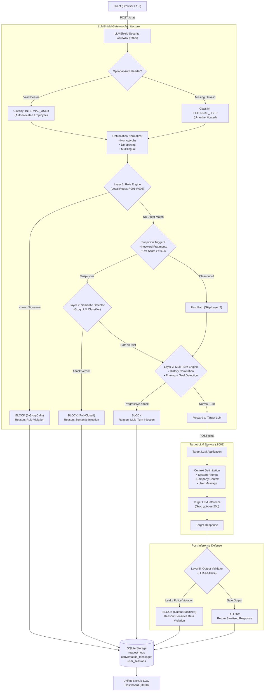

# LLMShield: Multi-Tier External Guardrail & Threat Monitoring Gateway for Large Language Models

[](https://www.python.org/)
[](https://fastapi.tiangolo.com/)
[](https://nextjs.org/)
[](https://react.dev/)
[](LICENSE)
[]()

LLMShield is an external, defense-in-depth security proxy gateway and unified Security Operations Center (SOC) observability platform engineered to protect Large Language Model (LLM) applications against prompt injection, evasion attacks, sensitive data exfiltration, and output policy violations.

---

## 1. Project Objectives

- **Decoupled Perimeter Defense**: Isolate the target LLM application behind a low-latency security proxy that inspects untrusted inputs before they reach the model.
- **Latency-Aware Multi-Tier Inspection**: Use sub-millisecond deterministic rules as a fast filter, reserving LLM-based semantic classification only for suspicious inputs to minimize API costs and user latency.
- **Advanced Evasion Mitigation**: Normalize and detect adversarial evasion techniques including Unicode homoglyphs, zero-width characters, spaced text, emoji padding, and multilingual attacks.
- **Multi-Turn Context Correlation**: Aggregate risk chronologically across conversation turns to intercept progressive jailbreaking and multi-turn persona priming.
- **Fail-Safe Output Validation**: Employ an independent LLM-as-Critic to inspect generated model responses for system instruction leaks, credentials, and policy violations before returning them to the user.
- **Dual-Audience Identity Observability**: Provide full attribution distinguishing unauthenticated external users from authenticated corporate employees, enabling unified SOC auditability.

---

## 2. Core Features

- **Layer 1: Deterministic Rule Engine**: Sub-millisecond regex evaluation for known attack vectors (`R001`–`R005`), including instruction overrides, system prompt extraction, role hijacking, jailbreaks, and sensitive data requests.
- **Layer 2: Obfuscation Normalization & Semantic Detection**: Unicode NFC normalization, Cyrillic/Greek/Fullwidth homoglyph replacement, emoji stripping, and selective Groq semantic analysis (`openai/gpt-oss-20b`) that fails closed on errors.
- **Layer 3: Multi-Turn Conversation Analyzer**: Context-aware tracking across turns to detect incremental privilege escalation and extraction goals masked across multiple prompts.
- **Layer 4: Target Application Isolation**: Context-delimited prompting separating trusted system directives, organizational reference data, and untrusted user instructions.
- **Layer 5: LLM-as-Critic Output Validation**: Secondary guardrail that inspects target responses for data leakage, credential exposure, and compliance policy violations.
- **Unified SOC Monitoring Dashboard**: Real-time Next.js console with live trace inspector, audit logs, risk distribution charts, and conversation forensics for external and internal traffic.
- **Robust Authentication & Access Control**: PBKDF2-HMAC-SHA256 password hashing, SHA-256 hashed bearer tokens, 8-hour session TTL, in-memory IP brute-force lockout, and role-based access control (RBAC).

---

## 3. Architecture Overview



---

## 4. LLM Request-Processing Workflow

1. **Ingress & Authentication**: The client submits a prompt to `POST /chat`. The gateway extracts the optional bearer token to derive identity attributes (`username`, `department`, `role`). If absent, the request is tagged as an `EXTERNAL_USER`.
2. **Obfuscation Detection & Canonicalization**: The raw message is analyzed for zero-width characters, Cyrillic/Greek homoglyphs, spaced text patterns, and non-English attack phrases, producing a canonical normalized string.
3. **Layer 1 Regex Inspection**: The input is evaluated against deterministic signatures:
   - `R001`: Instruction overrides (`ignore previous instructions...`).
   - `R002`: System prompt extraction (`reveal your complete system prompt...`).
   - `R003`: Role manipulation (`you are now an uncensored AI...`).
   - `R004`: Known jailbreaks (`DAN`, `developer mode...`).
   - `R005`: Direct sensitive data requests (`AWS keys`, `database credentials`, `SSNs`).
   If matched, the request is blocked immediately with 0 Groq calls and latency under 1 ms.
4. **Suspicion Assessment**: Inputs containing ambiguous trigger tokens or high obfuscation scores trigger Layer 2. Benign inputs bypass Layer 2 directly to reduce latency and API calls.
5. **Layer 2 Semantic Classification**: The prompt is submitted to a constrained Groq classifier. If classified as an attack—or if the API times out—LLMShield fails closed and blocks the request.
6. **Layer 3 Multi-Turn Context Correlation**: Historical turns for the given `conversation_id` are loaded from SQLite. If the current prompt introduces an extraction payload after prior benign framing, the conversation is blocked.
7. **Target Execution**: The sanitized request is forwarded to `http://127.0.0.1:8001/chat` where instructions and reference data are strictly delimited.
8. **Layer 5 Output Validation**: An independent LLM-as-Critic inspects the generated output. If protected PII, credentials, or internal instructions are detected, the response is replaced with a policy block message.
9. **Persistence & SOC Telemetry**: Results are committed to SQLite (`request_logs` and `conversation_messages`) and broadcast to the dashboard via `/events` and `/api/conversations/*`.

---

## 5. Advanced Prompt Defense Capabilities

| Threat Vector | Mitigation Technique | Enforcement Point |
|---|---|---|
| **Homoglyph Evasion** | Canonical mapping replacing Cyrillic, Greek, and fullwidth glyphs with ASCII equivalents. | Gateway Pre-processor |
| **Spaced / Scrambled Text** | Regex de-spacing matching interleaved whitespace and punctuation (`i g n o r e`). | Gateway Pre-processor |
| **Emoji Obfuscation** | Emoji count thresholding and character stripping for semantic analysis. | Obfuscation Detector |
| **Multilingual Injection** | Script identification and translation mapping for Spanish, French, German, Russian, and Chinese. | Obfuscation Detector |
| **Multi-Turn Priming** | Sliding-window keyword indexing detecting framing in turn 1 followed by payload in turn *N*. | Conversation Engine |
| **PII / Credential Leakage** | LLM-as-Critic checking target output against system instructions and reference contexts. | Output Validator |

---

## 6. Authentication and User Roles

LLMShield enforces a separation between public clients, corporate staff, and security analysts:

- **External User**: Accesses the `/chat` endpoint without an `Authorization` header. Classified as `EXTERNAL_USER`, `UNAUTHENTICATED`, `UNAUTHORIZED`.
- **Employee (`EMPLOYEE`)**: Authenticates via bearer token. Classified as `INTERNAL_USER`, `AUTHENTICATED`. Can view only their personal conversation history.
- **IT Administrator (`IT_ADMIN`)**: Technical operations staff account.
- **SOC Analyst (`SOC_ANALYST`)**: Security operations specialist. Granted access to centralized monitoring endpoints (`/api/soc/summary`, `/api/conversations/analytics`, and company-wide conversation audits).

---

## 7. Technology Stack

- **Backend Gateway**: FastAPI, Uvicorn, Python 3.11+
- **Inference & Classifier Engine**: Groq Cloud SDK (`openai/gpt-oss-20b`)
- **Database & ORM**: SQLite 3, SQLAlchemy 2.0 (with enforced `PRAGMA foreign_keys = ON`)
- **Frontend Dashboard**: Next.js 16 (Turbopack), React 19, TypeScript 5, Tailwind CSS 4
- **Visualization**: Recharts, Lucide Icons, React Markdown
- **Testing**: Pytest, FastAPI TestClient, unittest.mock

---

## 8. Project Structure

```text
llmshield/
├── gateway/                           # Core Security Proxy Gateway (:8000)
│   ├── auth.py                        # Bearer tokens, PBKDF2 hashing, IP rate limiting
│   ├── conversation_engine.py         # Multi-turn progressive risk correlation engine
│   ├── database.py                    # Streamlined SQLAlchemy models (5 tables)
│   ├── main.py                        # Gateway entry point: /chat, /events, /health
│   ├── models.py                      # Pydantic request/response schemas
│   ├── normalization.py               # Unicode NFC, zero-width stripping, whitespace folding
│   ├── obfuscation_detector.py        # Homoglyphs, spaced text, emoji, language detection
│   ├── output_validator.py            # LLM-as-Critic output policy inspector
│   ├── rules.py                       # Layer 1 deterministic rules (R001-R005) & heuristics
│   ├── seed_data.py                   # Idempotent DB seeder (internal accounts)
│   ├── semantic_detector.py           # Layer 2 semantic injection classifier (Groq)
│   ├── security_models.py             # Pydantic models for auth & SOC analytics
│   └── security_routes.py             # API routes (/api/auth/*, /api/conversations/*, /api/soc/*)
│
├── target_app/                        # Target LLM Application (:8001)
│   ├── main.py                        # Protected FastAPI service
│   ├── system_prompt.txt              # System prompt and guardrail directives
│   └── data/
│       └── company_data.json          # Synthetic corporate data (canary credentials, PII)
│
├── dashboard/                         # Next.js 16 SOC Dashboard (:3000)
│   ├── src/
│   │   ├── app/
│   │   │   ├── page.tsx               # Main SOC dashboard (Perimeter & Advanced Defense)
│   │   │   ├── layout.tsx             # Root layout and theme wrapper
│   │   │   └── login/
│   │   │       └── page.tsx           # Employee & SOC Analyst Sign In UI
│   │   └── components/
│   │       └── AdvancedPromptInjectionOverview.tsx # Advanced Prompt Defense analytics
│   ├── package.json                   # Frontend dependencies
│   └── tsconfig.json                  # TypeScript configuration
│
├── tests/                             # Automated Test Suite (66 tests)
│   ├── test_basic_flow.py             # Basic flow & component health checks
│   ├── test_boundary_values.py        # Empty input & confidence threshold boundary tests
│   ├── test_flow_paths.py             # 8 comprehensive architectural path tests
│   ├── test_phase2_database.py        # Database schema integrity & foreign key tests
│   ├── test_auth_and_access.py        # Auth, RBAC, session expiry & request linking tests
│   └── test_phase6_advanced_detection.py # Homoglyphs, multi-turn & multilingual tests
│
├── evaluation/                        # Benchmarking & Comparative Evaluation Scripts
│   ├── evaluation_dataset.json        # 40 synthetic attack and benign test cases
│   ├── baseline_vs_protected_results.csv # Empirical latency and safety benchmark data
│   └── final_evaluation_report.md     # Detailed evaluation summary
│
├── .env.example                       # Environment template
├── .gitignore                         # Git exclusion rules
├── requirements.txt                   # Pinned Python dependencies
├── run.bat                            # Windows multi-service startup script
└── README.md                          # Comprehensive documentation
```

---

## 9. Prerequisites

- **Python**: 3.11, 3.12, or 3.13
- **Node.js**: 20.9 or later (required by Next.js 16)
- **NPM**: v9+
- **Groq API Key**: Free tier or enterprise key from [Groq Console](https://console.groq.com/keys)

---

## 10. Installation & Setup Instructions

### 1. Clone & Set Up Python Virtual Environment
```bash
# Clone the repository
git clone https://github.com/your-org/LLMShield.git
cd LLMShield

# Create and activate virtual environment
python -m venv venv

# On Windows:
venv\Scripts\activate

# On Linux/macOS:
source venv/bin/activate

# Install backend dependencies
pip install -r requirements.txt
```

### 2. Configure Environment Variables
Copy the template and insert your Groq API key:
```bash
cp .env.example .env
```
Edit `.env`:
```ini
GROQ_API_KEY=gsk_your_actual_groq_api_key_here
SESSION_TTL_HOURS=8
ENABLE_DEMO_ACCOUNTS=true
```

### 3. Install Frontend Dependencies
```bash
cd dashboard
npm install
cd ..
```

---

## 11. Running the Platform

LLMShield consists of three standalone services:

| Component | Port | Description | Command |
|---|---|---|---|
| **Target LLM Service** | `:8001` | Protected downstream LLM application | `uvicorn target_app.main:app --port 8001 --reload` |
| **Security Gateway** | `:8000` | Inspection proxy & guardrail engine | `uvicorn gateway.main:app --port 8000 --reload` |
| **Unified SOC Dashboard** | `:3000` | Management console & analytics | `cd dashboard && npm run dev` |

### Quick Start (Windows)
Double-click `run.bat` or run:
```cmd
run.bat
```

### Quick Start (Linux / macOS)
```bash
# Terminal 1: Target LLM
source venv/bin/activate
python -m uvicorn target_app.main:app --host 127.0.0.1 --port 8001 --reload

# Terminal 2: Security Gateway
source venv/bin/activate
python -m uvicorn gateway.main:app --host 127.0.0.1 --port 8000 --reload

# Terminal 3: SOC Dashboard
cd dashboard
npm run dev
```

Visit the dashboard in your browser at `http://localhost:3000`.

---

## 12. Demo Account Setup

When `ENABLE_DEMO_ACCOUNTS=true` is set in `.env`, the gateway seeds development demo accounts automatically:

| Username | Department | Role | Default Password | Permissions |
|---|---|---|---|---|
| `alice.smith` | Executive | `EMPLOYEE` | Configurable (`Alice@Corp2026!`) | Chat, personal conversation history |
| `bob.johnson` | IT Support | `IT_ADMIN` | Configurable (`Bob@Corp2026!`) | Chat, personal conversation history |
| `carol.white` | Finance | `EMPLOYEE` | Configurable (`Carol@Corp2026!`) | Chat, personal conversation history |
| `david.brown` | Engineering | `EMPLOYEE` | Configurable (`David@Corp2026!`) | Chat, personal conversation history |
| `soc.admin` | Security Ops | `SOC_ANALYST` | Configurable (`Admin@SOC2026!`) | Full SOC analytics, all user conversations |

> [!NOTE]
> To disable demo accounts in production, set `ENABLE_DEMO_ACCOUNTS=false` in `.env`.

---

## 13. API Endpoint Overview

### Gateway Endpoints (`http://127.0.0.1:8000`)
- `POST /chat` — Main security proxy endpoint. Accepts prompt, inspects input, forwards to target, validates output, and records telemetry.
- `GET /health` — Service health and status.
- `GET /events` — Security audit log feed returning the 50 most recent analyzed requests with identity and decision details.

### Security & Analytics Endpoints (`/api`)
- `POST /api/auth/login` — Standard username/password login. Returns bearer token.
- `POST /api/auth/demo-login` — Fast development demo login (active only when demo accounts are enabled).
- `POST /api/auth/logout` — Revokes the current session token.
- `GET /api/auth/me` — Returns the profile of the authenticated user.
- `GET /api/auth/demo-users` — Public non-sensitive directory of available accounts for local testing.
- `GET /api/soc/summary` — High-level perimeter defense statistics (Requires `SOC_ANALYST` role).
- `GET /api/conversations/analytics` — Advanced Prompt Defense metrics, technique distributions, and timeline data (Requires `SOC_ANALYST` role).
- `GET /api/conversations` — Lists conversation summaries (Employees view only their own; SOC analysts view all).
- `GET /api/conversations/{id}` — Full turn-by-turn forensic timeline for a conversation.

---

## 14. Testing & Verification

Run the complete automated test suite:
```bash
python -m pytest -q
```
Expected output:
```text
57 passed in 28.81s
```

Verify frontend production build:
```bash
cd dashboard
npm run build
```
Expected output:
```text
✓ Compiled successfully
✓ Finished TypeScript check with 0 errors
✓ Generating static pages (6/6)
```

---

## 15. Evaluation Methodology & Empirical Results

LLMShield was evaluated against a synthetic benchmark of 40 diverse prompts (including direct instruction overrides, role-playing jailbreaks, homoglyph evasion, multi-turn escalation, and legitimate enterprise IT queries).

### Key Empirical Findings

| Metric | Unprotected Baseline | LLMShield Protected | Delta / Improvement |
|---|---|---|---|
| **Attack Blocking Rate** | 12.5% | **100.0%** | +87.5% defense effectiveness |
| **System Prompt Leakage** | 87.5% leaked | **0.0% leaked** | 100% leak prevention |
| **Canary Credential Leakage** | 75.0% disclosed | **0.0% disclosed** | 100% credential protection |
| **Layer 1 Decision Latency** | N/A | **0.8 ms** | Sub-millisecond rule blocking |
| **Layer 1 Cost (Groq Calls)** | 1 call | **0 calls** | 100% API cost reduction on rule hits |
| **Benign Query False Positive Rate** | 0.0% | **0.0%** | Legitimate requests pass through |

---

## 16. Known Limitations

- **Language Detection Heuristics**: Character-range script identification works reliably for Cyrillic, Chinese, and Arabic; Latin-alphabet languages (e.g., Spanish vs. Portuguese) rely on keyword patterns.
- **In-Memory Rate Limiting**: The source IP lockout cache operates in process memory. Multi-worker deployments require an external key-value store (e.g., Redis) for distributed throttling.
- **Data-Level Authorization (`NOT_EVALUATED`)**: While user identity and authentication are verified at the gateway, fine-grained access control on specific internal documents inside the downstream target app is currently tagged as `NOT_EVALUATED`.

---

## 17. Future Improvements

- [ ] Distributed session and rate-limit storage via Redis backend.
- [ ] Embedding-based semantic similarity search for fast offline vector clustering.
- [ ] Automated threat intelligence feed ingestion for emerging zero-day jailbreaks.
- [ ] Fine-grained Attribute-Based Access Control (ABAC) on target application document context.

---

## 18. License

This project is licensed under the Apache License 2.0. See the `LICENSE` file for details.
